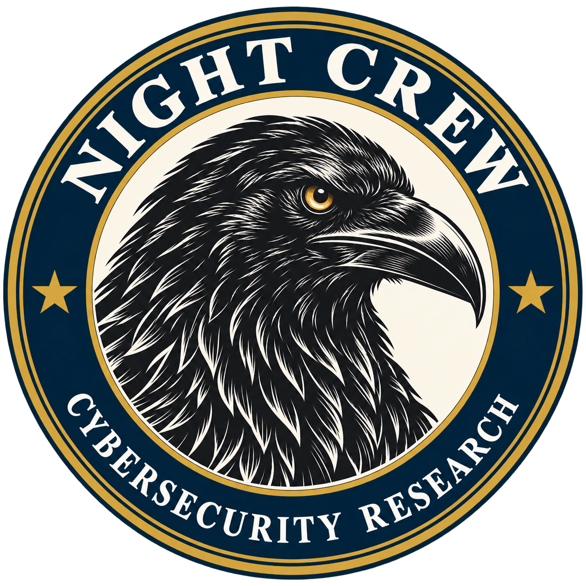
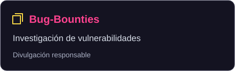
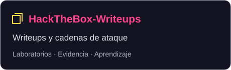
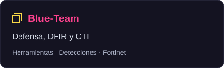
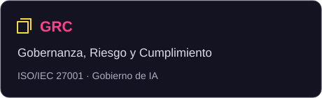
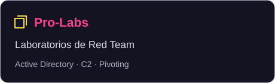
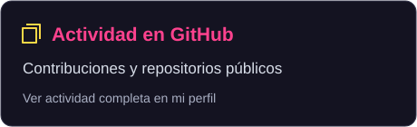

<div align="center">


# Kurosaki · Security Research

**Investigación de vulnerabilidades · Seguridad ofensiva · Defensa, CTI y GRC**

[](https://www.linkedin.com/in/edeclerck/)
[](https://bugcrowd.com/h/kurosaki)
[](https://app.hackthebox.com/public/users/773466)
[](https://github.com/kur0s4k1)

</div>

---

## Perfil profesional

Profesional de **ciberseguridad** con foco en **investigación de vulnerabilidades** y **operaciones de seguridad de extremo a extremo**. Traduzco hallazgos técnicos en **reducción medible de riesgo**: desde el descubrimiento responsable de vulnerabilidades y la validación de controles, hasta la detección, la respuesta a incidentes y el gobierno de seguridad (ISO/IEC 27001).

<p align="center">
  <br />
  Miembro de <strong>NIGHT CREW</strong>.
</p>

```text
Research ──▶ Exploit (safe) ──▶ Detect ──▶ Defend ──▶ Reduce Risk
   │              │               │           │            │
Vulnerability   PoC / AppSec   Purple Team  CTI / DFIR   ISO/IEC 27001
 Research       AD / API        Detections   Threat Hunt  Risk Mgmt
```

> *Mentalidad ofensiva, propósito defensivo.* Cada debilidad documentada viene con su detección y su mitigación.

---

## Áreas de especialización

| Área | Foco |
|---|---|
| **Red Team** | Pentesting, AppSec, APIs, Active Directory, C2 y simulación adversaria |
| **Blue Team** | Threat Hunting, CTI, DFIR, ingeniería de detecciones y respuesta a incidentes |
| **GRC** | ISO/IEC 27001, gestión de riesgos, controles, políticas y cumplimiento |

---

## 🔬 Vulnerability Research

### CVEs publicados

| CVE | Producto | Vulnerabilidad | Severidad |
|---|---|---|:--:|
| [**CVE-2026-48770**](https://www.cve.org/CVERecord?id=CVE-2026-48770) | Notepad++ | Out-of-Bounds Read / DoS vía `WM_COPYDATA` | **5.0 · Medium** |
| [**CVE-2026-46710**](https://www.cve.org/CVERecord?id=CVE-2026-46710) | Notepad++ Installer | Escalada local de privilegios (LPE) | **7.8 · High** |
| [**CVE-2026-71858**](https://www.cve.org/CVERecord?id=CVE-2026-71858) | Notepad++ | Bypass de protección HMAC | **5.4 · Medium** |
| *En revisión* | Notepad++ | Heap Buffer Overflow con fichero UTF-16 manipulado | **7.0 · High** |

### Líneas de investigación

`Memory Safety` · `Local Privilege Escalation` · `Authorization & Access Control` · `Application & API Security` · `Windows Security` · `Source Code Review` · `Attack Surface Analysis` · `Responsible Disclosure`

---

## 🎯 Bug Bounty

Hallazgos reportados a programas de **Bugcrowd**, **HackerOne** y **VDP directos**
(agencias y universidades), con divulgación responsable y detalle saneado.

| Métrica | Valor |
|:--|:--|
| Hallazgos reportados | **34** |
| Validados / aceptados | **13** |
| Recompensas acumuladas | **$$$$** |
| Organizaciones target | **18** |
| Clases de vulnerabilidad | **12** (IDOR, RCE, BAC, PII, ATO, SSRF…) |

**Targets:** NASA · WHO/OMS · DHS · Harvard · Drexel · HPE · Atlassian · CODE.ORG · Internet Brands · WordPress · GitLab · Vercel · ClickHouse · OpenAI · iFood y más.

> 📂 **[Ver portafolio completo → kur0s4k1/Bug-Bounties](https://github.com/kur0s4k1/Bug-Bounties)**

---

## 🌎 Reconocimientos

Reconocimientos por divulgación responsable y participación en competencias de ciberseguridad:

| Organización | Reconocimiento | Enlace |
|---|---|---|
| **NASA** — National Aeronautics and Space Administration | Hall of Fame público en Bugcrowd · Letter of Recognition | [Publicación](https://www.linkedin.com/feed/update/urn:li:activity:7397315738916761600/) |
| **Harvard University** | En espera de remediación | |
| **Drexel University** | Hall of Fame público en Bugcrowd · Letter of Recognition | [Publicación](https://www.linkedin.com/feed/update/urn:li:activity:7504227590581362688/) |
| **World Health Organization (WHO / OMS)** | Hall of Fame público en Bugcrowd | [Publicación](https://www.linkedin.com/feed/update/urn:li:activity:7511150457155907584/) |
| **Department of Homeland Security (DHS)** | Hall of Fame público en Bugcrowd | |
| **Hewlett Packard Enterprise (HPE)** | Hall of Fame en HackerOne | |
| **Atlassian** | Hall of Fame público en Bugcrowd | |
| **CodeAI** | Hall of Fame público en Bugcrowd | |
| **Internet Brands** | Hall of Fame público en Bugcrowd | |
| **Hackrocks · Equipo NIGHT CREW** | **6.º lugar a nivel nacional en Chile, en equipo.** Reconocimiento por la participación y resolución de desafíos de OSINT, análisis de binarios y hacking ético | [Certificado de participación](https://hackrocks.com/certs/be6c181a-642c-4a99-adb6-e7e383344805) |

---

## 📂 Proyectos destacados

<div align="center">

<a href="https://github.com/kur0s4k1/Bug-Bounties"></a>
<a href="https://github.com/kur0s4k1/HackTheBox-Writeups"></a>
<a href="https://github.com/kur0s4k1/Blue-Team"></a>
<a href="https://github.com/kur0s4k1/GRC"></a>
<a href="https://github.com/kur0s4k1/Pro-Labs"></a>

</div>

---

## 🎓 Certificaciones

**Ofensiva:** `CEH Master` · `CEH` · `CEH Practical` · `Puppet C2 Operations` · `CRTSv2` · `CAPenX` · `CRTA` · `C-APIPen` · `CASA` · `CNPen` · `CAPen` · `CRT-ID` · `CRTOM` · `COPO` · `CSCRB` · `DANTE` · `AD-RTS`

**Defensa:** `NSE7` · `NSE6` · `NSE5` · `NSE4` · `NNCCD` · `GCSE` · `GCSA` · `ONSA` · `vRx` · `CNSE` · `CBTeamerX` · `CNSP`

**GRC:** `ISO/IEC 27001:2022 Associate`

---

## 📊 Actividad

<div align="center">

<a href="https://github.com/kur0s4k1?tab=overview"></a>


</div>

---

<div align="center">

### `Research → Exploit → Detect → Defend → Reduce Risk`

**Security research con mentalidad ofensiva y propósito defensivo.**

<sub>Divulgación responsable · Todo el contenido publicado es con autorización o sobre activos propios.</sub>

</div>
